# DS605 Lab 7: Image Representation, PCA, Eigenfaces and Face Recognition

**Name:** Keval Anilbhai Patodiya

**Student ID:** 202618056

Face recognition on the **AT&T (ORL) Database of Faces**. PCA and eigenfaces are implemented from scratch with NumPy, then compared against raw-pixel matching and traditional ML classifiers.

- **Dataset:** 400 grayscale images, 40 subjects, 10 images each, 112 × 92 pixels (10,304 features per image)
- **Notebook:** `202618056_lab07.ipynb`
- **Constraint followed:** all PCA / eigenface computations use NumPy linear algebra (`np.linalg.eigh`, `np.linalg.svd`). Scikit-learn PCA is not used. Scikit-learn is used for the train/test split and the traditional-ML comparison (KNN, SVM, stratified cross-validation).

## Repository structure

```
.
├── 202618056_lab07.ipynb      # full runnable notebook
├── README.md
├── data/                      # AT&T faces: s1/ ... s40/ (each with 1.pgm ... 10.pgm)
└── figures/                   # figures exported from the notebook
```

## How to run

1. Place the AT&T face dataset in `data/` so that it contains folders `s1` to `s40`.
2. Install dependencies: `pip install numpy pillow matplotlib scikit-learn jupyter`
3. Open the notebook and run all cells from top to bottom.

## Approach

### Part A: Image representation
- Each image is read with Pillow, converted to grayscale and stored as a `uint8` matrix of shape (112, 92), with intensities between 0 and 255.
- Each image is flattened into a 10,304-dimensional vector, giving a feature matrix of shape **(400, 10304)** and a label vector of shape (400,).
- A reproducible **80/20 stratified split** (`random_state=42`) gives 320 training and 80 test images. All 40 subjects appear in both sets (8 train and 2 test images per subject).

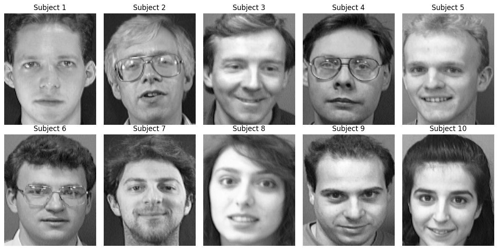

### Part B: PCA, eigenfaces and compression
1. **Mean face and centering.** The mean face is computed from the training set only and subtracted from the training images. The same training mean is used for test images, so there is no leakage.
2. **Eigendecomposition.** With 10,304 features and only 320 images, the full covariance matrix would be 10,304 × 10,304. Instead the small 320 × 320 matrix `X Xᵀ` is decomposed with `np.linalg.eigh`. Its eigenvectors are mapped back to pixel space (`Xᵀ v`) and normalized to give the eigenfaces. The first eigenface has unit norm and is orthogonal to the second.
3. **SVD.** `np.linalg.svd` is applied directly to the centered data matrix. Squared singular values match the eigenvalues, and the principal directions match the eigenfaces (cosine similarity 1.000000 for the first five components, up to sign). Both methods give the same PCA; SVD is numerically more stable and avoids forming `X Xᵀ`.
4. **Explained variance.** **98 components** are needed to retain at least 90% of the variance (90.06%).
5. **Projection.** Each face is compressed from 10,304 values to **98 coefficients**.

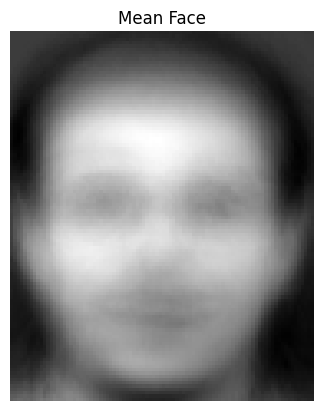
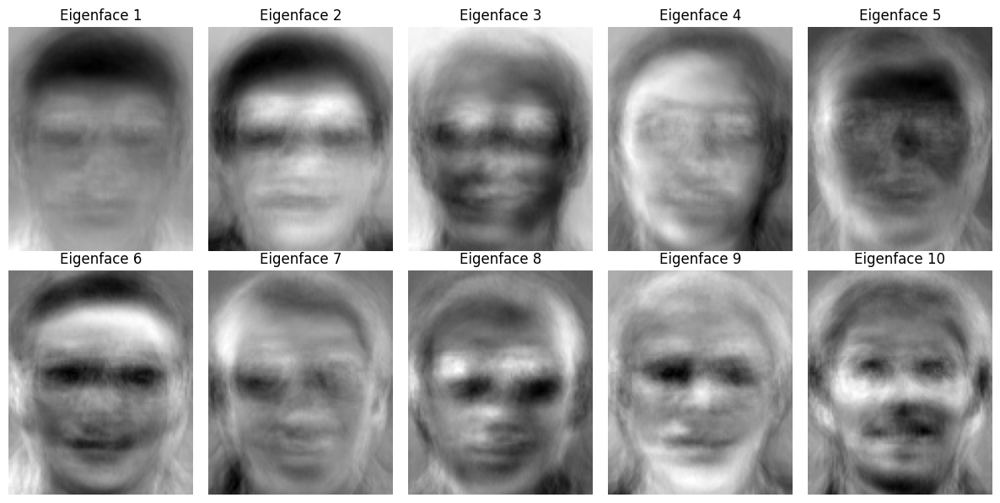
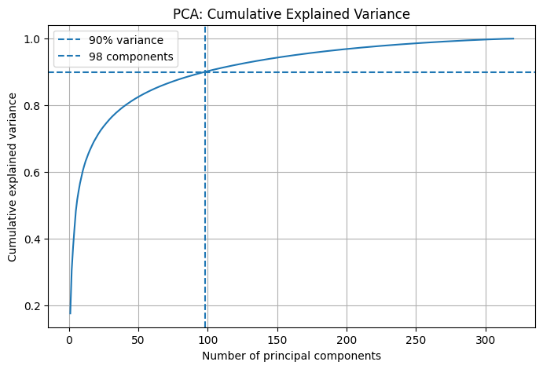
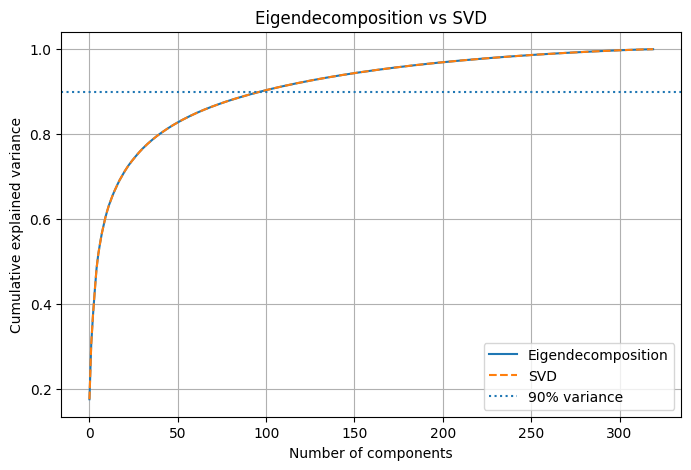

#### Reconstruction quality

Reconstruction from 98 components (MSE in squared pixel intensity):

| Set | MSE |
|---|---|
| Training | 154.68 |
| Test | 334.99 |

MSE against the number of retained components:

| Components | Train MSE | Test MSE |
|---|---|---|
| 10 | 616.11 | 664.88 |
| 25 | 409.11 | 500.87 |
| 50 | 271.44 | 404.31 |
| 100 | 151.40 | 333.40 |
| 150 | 88.39 | 304.74 |
| 200 | 48.25 | 284.94 |

Test error is higher than training error because the principal directions were fitted on the training faces only. Training error keeps falling quickly as components are added, while test error improves more slowly.

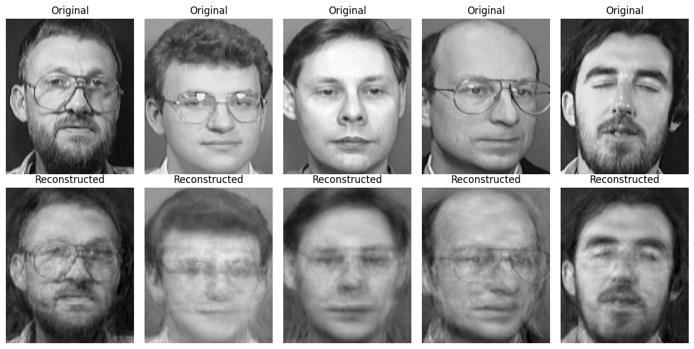
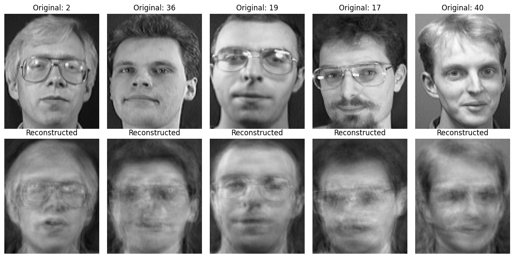

#### Storage comparison

| Representation | Values stored per image | Reduction per image |
|---|---|---|
| Raw pixels | 10,304 | n/a |
| PCA (98 components) | 98 | about 99.05% |

The per-image saving is large, but the shared PCA model must also be stored: the mean face (10,304 values) and the 98 eigenfaces (98 × 10,304 values). For the 320 training images that is 3,297,280 values for raw pixels against 1,051,456 for PCA including the model, a saving of about 68% overall. The saving grows as more faces are added, because the model is stored only once.

### Part C: Recognition in PCA space
Each test image is centered with the training mean, projected onto the 98 principal components, and matched to the closest stored training face by **Euclidean distance** (1-nearest-neighbour). The same matching is repeated on raw pixels for comparison.

| Method | Feature size | Accuracy |
|---|---|---|
| Raw pixels, nearest neighbour (Euclidean) | 10,304 | 96.25% (77 / 80) |
| PCA (98 components), nearest neighbour (Euclidean) | 98 | 96.25% (77 / 80) |

PCA matches the raw-pixel baseline while using about 100 times fewer features, so little identity information is lost. Of the 80 test faces, 3 were matched to the wrong subject.

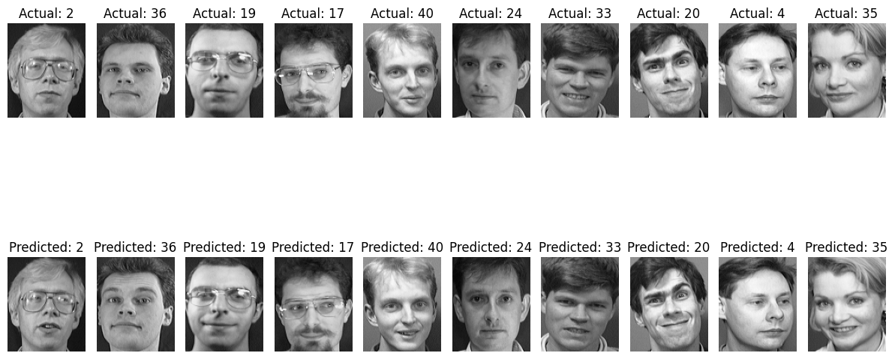
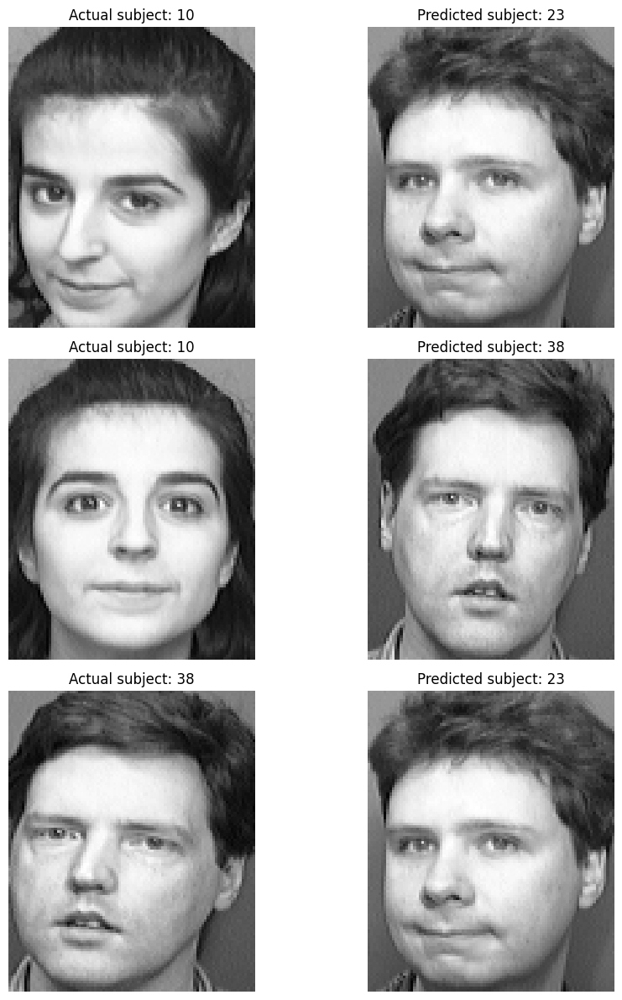

### Part D: Traditional machine learning
Two classifiers were trained on the 98-component PCA features and compared with the similarity-based baseline.

| Method | Test accuracy |
|---|---|
| PCA nearest neighbour (Euclidean, baseline) | 96.25% |
| KNN (k = 1) | 96.25% |
| SVM (RBF kernel, default C = 1) | **98.75%** (79 / 80) |

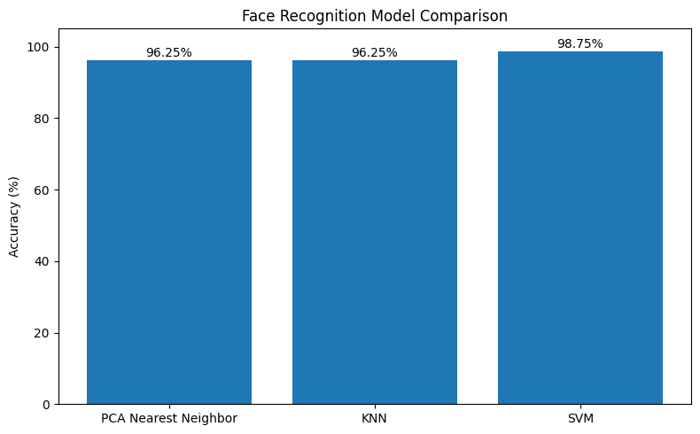
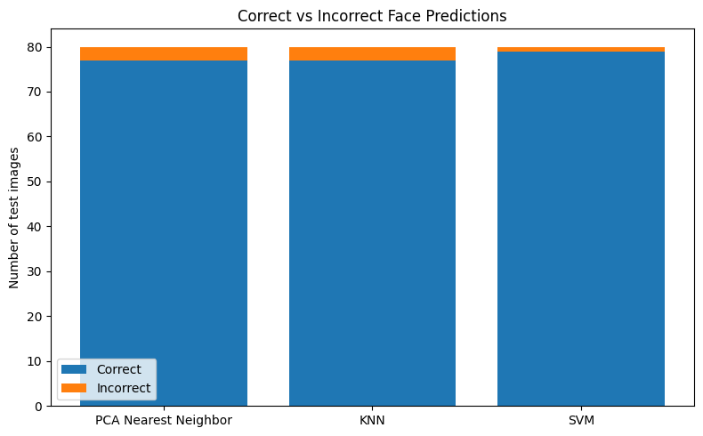

#### Tuning components and model settings
- A grid search was run over the number of components {10, 25, 50, 75, 98, 150, 200}, KNN k ∈ {1, 3, 5} and SVM C ∈ {0.1, 1, 10, 100}. SVM reached 98.75% test accuracy across a wide range of component counts, including 10 to 25 components.
- That grid was scored on the test set, so it is kept for reference only. The final choice uses **4-fold stratified cross-validation on the training set**, with PCA refitted inside every fold so no validation face influences the eigenfaces. The test set is then used once.

Best cross-validation results:

| Components | Model | CV accuracy |
|---|---|---|
| 50 or 75 | SVM (C = 10 or 100) | 98.12% ± 0.63 |
| 98 or 150 | SVM (C = 10 or 100) | 97.81% ± 0.54 |
| 25 | SVM (C = 10 or 100) | 96.56% ± 2.23 |

**Selected configuration (by cross-validation):** SVM with RBF kernel, C = 100, **75 PCA components**. Final test accuracy: **98.75%** (79 / 80). The representation shrinks from 10,304 values to 75 per image, about 99.3% smaller.

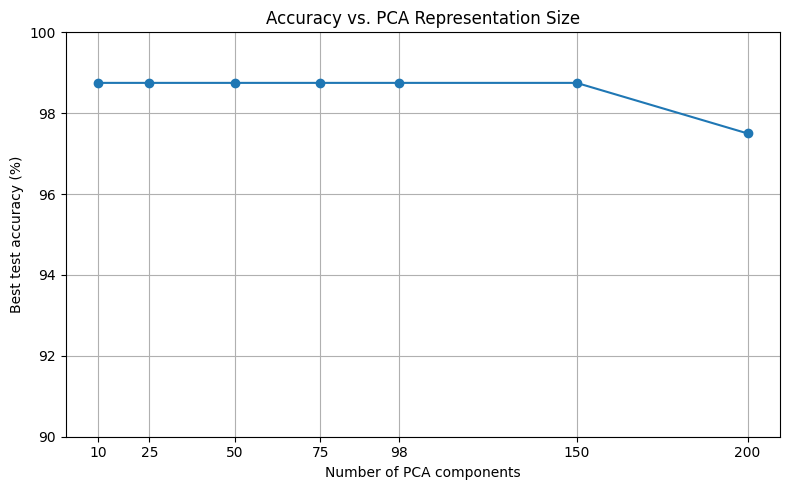

## Observations
- A few dozen principal components carry most of the identity information. 98 components preserve 90% of the variance, and recognition accuracy is already high with far fewer.
- Eigendecomposition on the small 320 × 320 matrix and SVD on the data matrix give identical principal directions. SVD is the safer choice numerically.
- PCA-based nearest-neighbour matching equals raw-pixel matching (96.25%) at about 1% of the feature size.
- An RBF SVM on PCA features gives the best result (98.75%), reducing the errors on this split from 3 to 1.
- Test reconstruction error is higher than training error, as expected, since the eigenfaces are learned from the training faces only.
- With only 80 test images, one image is worth 1.25 percentage points, so small accuracy differences between configurations are not statistically strong. This is why the cross-validated choice is preferred over the best single test score.
- Limitations: ORL images are well aligned with fairly controlled lighting and pose. PCA is a linear, global representation and is expected to be less robust under larger lighting or pose changes.
